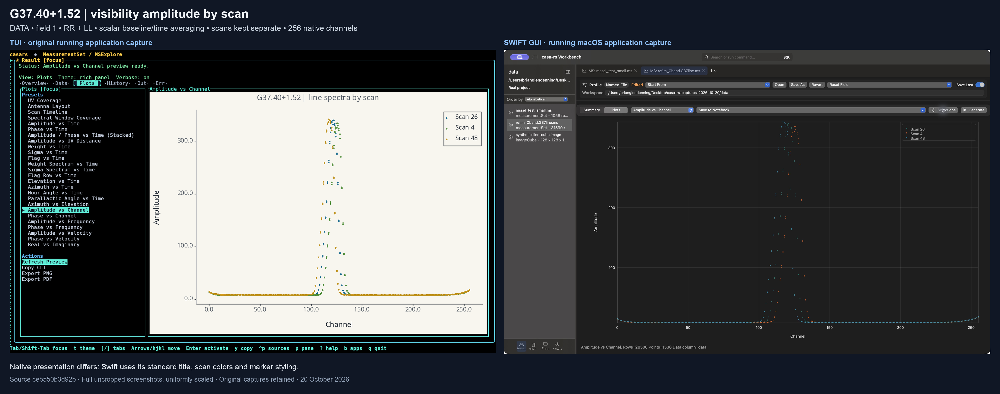
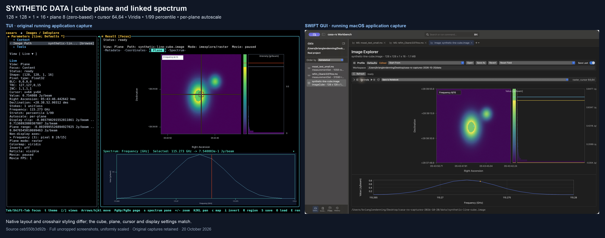
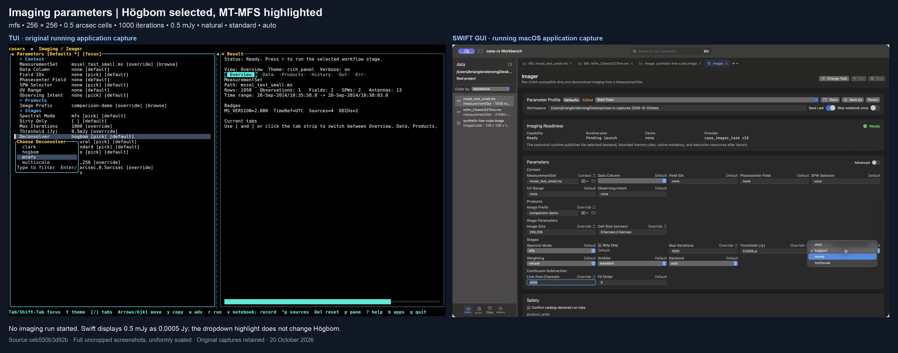
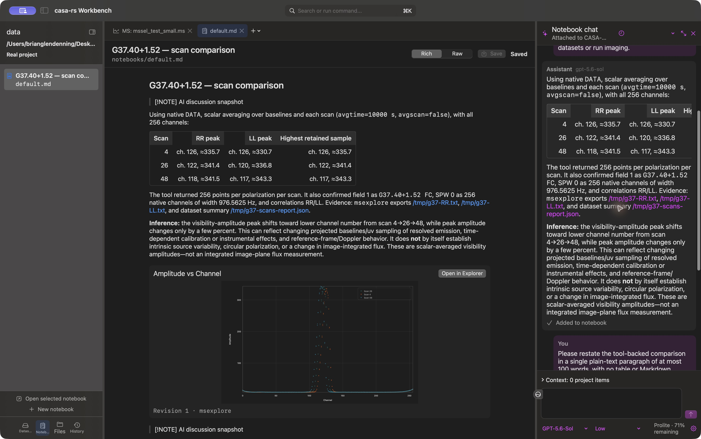

# casa-rs

Truth class: current descriptive
Last reality check: 2026-11-27
Verification: just docs-check


**`casa-rs` aims for functional parity with CASA and faster execution.** It
implements supported CASA workflows in Rust, with Python task and tool APIs,
interoperable MeasurementSets and images, and scientific results checked
against CASA. On Apple Silicon, casa-rs ran **17× faster for an ALMA
visibility simulation** and **13.7× faster for a VLASS imaging workload**
in recorded comparisons with CASA. See the [macOS benchmarks](#representative-macos-performance).
CASA and casacore serve as test and benchmark references. The Rust
implementation runs independently.

This is an experiment/hobby project by Brian Glendenning
(<i>brian@glendenning.net</i>), NRAO retiree.

The source is almost entirely written by AI. I switch between Claude and
Codex, prompting them using various strategies. Experimenting with development
methodology is part of the hobby. You are welcome to experiment with the code,
and I am happy to answer questions, but there is no institutional support.
Independently authored source is LGPL-3.0-or-later; FFTW-linked distributions
are GPL-3.0-or-later. See [License](#license).

Python is the user-facing surface, alongside reusable Rust libraries and
command-line tasks.

## CASA Compatibility

The 61 CASA-named Python tasks match the parameter order, argument kinds and
defaults of CASA 6.7.6.14. Supported options and behavioral coverage vary by
task. This list describes the source checkout. Published releases may lag
it. See the [CASA compatibility reference](docs/reference/casa-compatibility.md)
for supported parameters, paired tests and remaining gaps.

### Python tasks and tools

| Area | Tasks in `casars.tasks` |
|---|---|
| Imaging and image analysis | `exportfits`, `feather`, `imhead`, `immath`, `immoments`, `impbcor`, `importfits`, `impv`, `imregrid`, `imstat`, `imsubimage`, `tclean` |
| MeasurementSets and flagging | `concat`, `flagdata`, `flagmanager`, `importvla`, `initweights`, `mstransform`, `split`, `statwt` |
| Calibration and visibility models | `accor`, `appendantab`, `applycal`, `bandpass`, `blcal`, `calstat`, `clearcal`, `delmod`, `fluxscale`, `fringefit`, `ft`, `gaincal`, `gencal`, `getantposalma`, `getcalmodvla`, `getjyperkalma`, `listcal`, `pccor`, `polcal`, `polfromgain`, `rerefant`, `setjy`, `smoothcal`, `uvmodelfit`, `uvsub`, `wvrgcal` |
| Plotting | `plotbandpass`, `plotms` (static plots), `plotweather` |
| Simulation and observing utilities | `getephemtable`, `predictcomp`, `simalma`, `simanalyze`, `simobserve` |
| Single dish | `sdatmcor`, `sdbaseline`, `sdcal`, `sdfit`, `sdgaincal`, `sdsmooth`, `tsdimaging` |
| casa-rs additions | `calibrate`, `msconvert`, `msexplore` |

`casars.tools` exports `agentflagger`, `atmosphere`, `calanalysis`,
`calibrater`, `componentlist`, `coordsys`, `image`, `imager`, `measures`, `ms`,
`msmetadata`, `quanta`, `simulator`, `singledishms`, `table`, `tablerow`, and
`wvr`. The 435 public methods across `image`, `coordsys`, `table`, `msmetadata`
and `ms` passed behavioral acceptance against CASA 6.7.6.14. See the
[Python binding closeout](https://github.com/bglenden/casa-rs/issues/1025#issuecomment-7225120185).

### Representative macOS performance

These are recorded wall times on Apple Silicon. The simulator benchmark
replays CASA's `sm` session through the native simulator and includes visibility
prediction, noise and writing the MeasurementSet. The imaging runs include
product writes. The evidence records give the inputs, build revisions,
comparison conditions and checks against CASA's outputs.

| Workload | Mac and casa-rs backend | CASA | casa-rs | Speedup | Evidence |
|---|---|---:|---:|---:|---|
| `simulator`, ALMA 1024² model cube, 256 channels | M2 Mac mini, Metal | 191.7 s | 11.30 s | **17.0×** | [Simulation campaign, case 1](https://github.com/bglenden/casa-rs/pull/856) |
| Same ALMA cube on CPU | M2 Mac mini, CPU, three workers | 191.7 s | 12.20 s | **15.7×** | [Simulation campaign, case 1](https://github.com/bglenden/casa-rs/pull/856) |
| `tclean`, 63-field VLASS, 4096² AW-projection dirty image | M4 MacBook Air, CPU, four workers | 541 s | 39.5 s | **13.7×** | [VLASS B2, CASA 6.7.5.9](https://github.com/bglenden/casa-rs/issues/785#issuecomment-6281109988) |
| `tclean`, 63-field VLASS, 4096² AW-projection MT-MFS multiscale clean | M4 MacBook Air, CPU, four workers | 3,470.2 s | 260.0 s | **13.35×** | [VLASS B3, CASA 6.7.5.9](https://github.com/bglenden/casa-rs/issues/785#issuecomment-6281109988) |
| `tclean`, seven-pointing ALMA mosaic continuum clean, 1024² | M4 MacBook Air, Metal f32, one worker | 59.5 s | 7.11 s | **8.37×** | [Mosaic B10](https://github.com/bglenden/casa-rs/issues/787#issuecomment-6279476046) |
| `tclean`, 4096² continuum image, four spectral windows, Clark to 0.5 mJy | M4 MacBook Air, CPU f64, one worker | 246 s | 44.8–45.0 s | 5.5× | [Imaging row P17](https://github.com/bglenden/casa-rs/issues/648#issuecomment-6222278538) |
| `tclean`, 1024² VLA spectral cube, 512 channels | M4 MacBook Air, Metal f32, four workers | 21,623 s | 4,144 s | 5.22× | [Full-cube comparison](https://github.com/bglenden/casa-rs/issues/659#issuecomment-6203335788) |
| `simobserve`, ALMA disk simulation with atmospheric noise | Apple Silicon Mac mini, CPU | 2.42 s | 1.41 s | 1.71× | [Simulation case `psim2`](resources/casa-compat/evidence/simobserve-parity-20261103.json) |

## Current Status

Tests compare both implementations' reads and writes. Imaging acceptance
normally targets normalized RMS differences around 0.001 alongside metadata,
mask, beam, flux and other scientific checks. See [TESTING.md](TESTING.md).

| Capability | Current implementation |
|---|---|
| Tables and MeasurementSets | CASA-compatible storage managers, typed row/column/cell access, TaQL, MS selection and transformation, flag versions, and plotting/export data. |
| Images and coordinates | Persistent images, masks, regions, statistics, moments, image arithmetic, regridding, FITS import/export, coordinate systems, units, and measures. |
| Calibration and flagging | Native gain, bandpass, flux-scale, calibration application/generation, manual/clip/quack/tfcrop/rflag workflows, and diagnostic tasks. |
| Simulation and import | CASA's `sm` simulator tool, `simobserve`, multi-array/TP `simanalyze`, and `simalma`, including observation and image/analysis graphics ([ALMA disk tutorial](docs/tutorial-parity/ppdisk-alma.md)); component lists, the ATM atmosphere model, VLA archive import, and MSv2/MSv4 conversion, with comparison harnesses against CASA. |
| Imaging | Continuum and spectral cubes; standard, W-projection, mosaic, and AW-projection gridders; Högbom, Clark, multiscale, and MT-MFS deconvolution; masks, restoration, and primary-beam products. Not every combination is available. |
| Python | In-process NumPy-compatible table/image access, generated task wrappers, shared parameter profiles, and numeric MeasurementSet plot documents. |

The imaging foundation uses one compile/plan/run path through `casa-imaging`,
with separate owners for the measurement operator, deconvolution, products,
execution, and Metal acceleration. Explicitly
unsupported requests fail before execution. Current limits include:

- AW projection supports continuum/MT-MFS, not spectral cubes; native
  convolution-function generation is EVLA-specific.
- MT-MFS reconstructs Stokes I in one image domain.
- Facets use the standard gridder with single-term MFS.
- Metal supports standard and mosaic gridding with `f32` grids on suitable
  macOS hardware; W and AW projection use the CPU.

The authoritative availability checks are in
[`availability.rs`](libs/imaging/casa-imaging/src/availability.rs).
Current work and remaining acceptance obligations live in
[GitHub issues](https://github.com/bglenden/casa-rs/issues) and pull requests.

## Documentation

- [Documentation site](https://bglenden.github.io/casa-rs/)
  and [Rust API reference](https://bglenden.github.io/casa-rs/rustdoc/).
- [Python overview](docs/python/index.md), [data API](docs/python/data.md),
  and [API reference](docs/python/api.md).
- [Task parameter profiles](docs/task-parameters.md) and the
  [generated parameter reference](docs/reference/task-parameters.md).
- [Calibration guide](docs/casars-calibrate-user-guide.md).
- [Documentation index](docs/README.md), [architecture](ARCHITECTURE.md),
  and [testing and scientific evidence](TESTING.md).

The published docs are built from `main`. For a checkout or release tag, use
its corresponding source documentation.

## Using Python

The distribution is named `casa-rs-python`; import it as `casars`.

### Persistent data in process

```python
from casars.tools import image, table

ms = table()
ms.open("observation.ms")
print(ms.nrows(), ms.colnames())
ms.close()

ia = image()
ia.open("target.image")
print(ia.shape(), ia.brightnessunit())
ia.done()
```

Use `nomodify=False` to open a writable table. The image tool can create a
native image, edit coordinates and write a slice with `putchunk`. See the
[data API](docs/python/data.md) for examples.

### Tasks and reusable parameters

```python
from casars import tasks

stats = tasks.imstat("target.image")
print(stats["rms"])
```

Named wrappers take CASA's parameters and run in the current directory;
`tasks.run(task_name, parameters=None, /, *, workspace=None, **values)` runs
any catalog task from a draft, in a chosen workspace. Each call resolves its
parameters through the shared Rust contracts and runs in process. The task's
log reaches `sys.stderr` as it runs. CASA-named wrappers return CASA's value,
such as `imstat`'s statistics dictionary, `flagdata`'s summary, `fluxscale`'s
flux densities or `tclean`'s summary record. Parameter refusals raise
`casars.tasks.TaskParameterError`, a `ValueError`. Failed executions raise
`casars.tasks.TaskExecutionError`.
Parameters can also be loaded, edited, validated, and saved as sparse TOML
profiles:

```python
from casars import parameters, tasks

p = parameters.load("profiles/target-imaging.toml", workspace="project")
p.update(niter=20000, threshold="1mJy")
result = tasks.run("tclean", p)
```

A task's command line (each task executable, such as `calibrate gaincal
...`) saves Last and Last Successful parameters in the workspace; Python task
calls save neither. CASA's own parameters are the consent to change data:
`overwrite=True` replaces a product, and a task that changes data in place
does so, as in CASA.
See [task parameters](docs/task-parameters.md) and the
[generated reference](docs/reference/task-parameters.md) for defaults and
supported options.

## Rust Libraries and Source Layout

`casa-*` crates contain reusable domain libraries and shared contracts;
`casars-*` crates contain the imager application, the `imexplore`,
`msconvert` and `simobserve` task executables, and the Python package; the other task
executables are binaries of their domain crates. This is a native
implementation, not a wrapper around casacore C++.

| Area | Crates or source |
|---|---|
| Values and foundations | `casa-core`, `casa-aipsio` |
| Persistent data | `casa-tables`, `casa-ms`, `casa-observation`, `casa-lattices`, `casa-images` |
| Coordinates and runtime catalogs | `casa-coordinates`, `casa-measures` |
| Numerics and Fourier transforms | `casa-numerics`, `casa-fft` |
| Calibration, simulation, import | `casa-calibration`, `casa-singledish`, `casa-simulation`, `casa-components`, `casa-atmosphere`, `casa-vla` |
| Imaging | `casa-imaging-model`, `casa-imaging-operator`, `casa-imaging-deconvolution`, `casa-imaging-products`, `casa-imaging-runtime`, `casa-imaging-metal`, `casa-imaging-singledish`, `casa-imaging-application` |
| Task contracts and execution | `casa-provider-contracts`, `casa-task-runtime`, `casars-imager`, `casars-imexplore`, `casars-msconvert`, `casars-simulation` |
| Python | `frontends/casars-python/`, with its PyO3 extension `casars._core` |
| Comparison and test support | `dev/casa-test-support`, `dev/casa-dev-tools`, `suites/`, `tools/science/` |

The [application catalog](surfaces/casa-contracts/resources/application-catalog.json)
and [parameter surfaces](surfaces/casa-contracts/resources/parameter-surfaces.json)
are shared by the task executables and Python. The
[architecture document](ARCHITECTURE.md) describes ownership and dependency
rules in detail.

For example, the public `casa-core` value model can hold scalar, array, and
record values:

```rust
use casa_core::{ArrayValue, RecordField, RecordValue, ScalarValue, Value};

let temperature = Value::Scalar(ScalarValue::Float64(273.15));
let spectrum = Value::Array(ArrayValue::from_f32_vec(vec![1.0, 2.0, 3.0]));
let metadata = Value::Record(RecordValue::new(vec![
    RecordField::new("name", Value::Scalar(ScalarValue::String("demo".into()))),
    RecordField::new("temperature", temperature),
    RecordField::new("spectrum", spectrum),
]));
```

The crate APIs are idiomatic Rust, not a one-to-one copy of casacore's C++ API.
FITS image I/O currently uses `fitsio`/CFITSIO, and Fourier transforms use
FFTW. Broad casacore module parity, including its general fitting/scimath
and Python-converter APIs, is not the goal.

## License

Independently authored source is licensed under the [GNU Lesser General Public
License v3.0 or later](COPYING.LESSER) (SPDX: `LGPL-3.0-or-later`). Imaging
applications and Python extensions linked with FFTW are distributed as
combined works under [GNU GPL v3.0 or later](COPYING). See
[third-party notices](THIRD_PARTY_NOTICES.md) for FFTW's copyright and license.

## UI Experiments

We explored several user interfaces for casa-rs: Python bindings, a terminal
user interface (TUI), and a native Swift GUI. These experiments demonstrated
that multiple interfaces can share the same computational codebase and
task schemas, without reimplementing the scientific algorithms.

The TUI worked well in Ghostty using the kitty graphics protocol. This
approach is potentially portable across macOS, Windows, and Linux with a
compatible terminal, although only macOS was tested. In 2026, I am unsure
how much value a TUI adds when the cost of creating a native GUI is no longer
particularly high.

The Swift GUI also worked well and had no difficulty interoperating with
the main Rust computational codebase. The comparisons below show the TUI
on the left and the Swift GUI on the right.

*Visibility-amplitude spectra from the same G37.40+1.52 MeasurementSet and
selection. These are visibility amplitudes, not image-integrated flux.*



*The same plane of a synthetic image cube, with its linked spectrum.
This is synthetic test data.*



*Imaging parameter controls in the two interfaces.*



I also created an experimental notebook system with an integrated AI
assistant. Keeping discussion, analysis results, and plots together seemed
very promising. The screenshot below shows a genuine assistant conversation
that inspected the dataset through tools, with its response and a spectrum
saved in the notebook. I am still unsure how much this adds over using a
coding agent with the Python bindings, or a notebook environment such as
Jupyter AI.



Python is the focus for continued work. The TUI, the Swift GUI, the notebook
and assistant, the interactive image and table browsers, and Rust-side plot
rasterisation were removed in October 2026 (issue #833; see
[ADR-0017](docs/adr/0017-python-first-surface.md)). Their last state is
preserved at the tag
[`ui-experiments-2026-10-20`](https://github.com/bglenden/casa-rs/tree/ui-experiments-2026-10-20).

## Installation

The suite installer and release workflow target **macOS arm64** and
**Linux x86_64**. The release workflow builds CPython **3.10, 3.11, and 3.12**
wheels. Package metadata permits Python 3.10 or newer, but that does not mean
every newer interpreter has a bundled wheel. Choose an interpreter matching
the release's wheel assets.

### Install a published suite

Choose a version from the [releases page](https://github.com/bglenden/casa-rs/releases)
and run the installer attached to it, with `version` set to the version number
without the leading `v`:

```bash
curl -fsSL "https://github.com/bglenden/casa-rs/releases/download/v${version}/install-casa-rs.sh" \
  -o install-casa-rs.sh
bash install-casa-rs.sh --version "$version" --python python3.12
export PATH="$HOME/.local/bin:$PATH"
source "$HOME/.local/opt/casa-rs/current/python/bin/activate"
```

This installs the task executables and a Python environment together under
`~/.local/opt/casa-rs/<version>/` and links the commands into `~/.local/bin`.
[Install](docs/install.md) covers release candidates, channels, the commands
kept off `PATH`, and running tasks from a wheel installed outside a suite.

### Build from source

Source builds require Rust at least `Cargo.toml`'s `rust-version`, a C/C++ toolchain, `pkg-config`,
and FFTW single- and double-precision libraries including their threaded/static
archives. Python packaging additionally needs Python 3.10 or newer and its
virtual-environment support. Install `just` for the repository commands.

Typical native dependencies:

```bash
# macOS
xcode-select --install
brew install fftw pkg-config just

# Debian/Ubuntu (install just separately if needed)
sudo apt install build-essential libfftw3-dev pkg-config python3-dev python3-venv
```

From the repository root:

```bash
rustup update stable
CARGO_INCREMENTAL=0 cargo build --release --workspace --bins
```

To build and install the Python/command-line suite from the checkout:

```bash
CARGO_INCREMENTAL=0 just install-local-suite
```

For an editable Python development environment, install the package from the checkout.

```bash
python3 -m venv .venv
source .venv/bin/activate
CARGO_INCREMENTAL=0 python -m pip install -e 'frontends/casars-python[test,plot]'
```

To build a standalone CLI command, use `cargo build -p casars-cli --bin <executable>`.
The [application catalog](surfaces/casa-contracts/resources/application-catalog.json)
maps task surfaces to their CLI commands.

Before building for performance measurements or release, use the pinned
SIMD-enabled FFTW recipe rather than assuming the system package has the
required kernels:

```bash
bash scripts/build-fftw.sh /absolute/durable/fftw-3.3.11
export PKG_CONFIG_PATH=/absolute/durable/fftw-3.3.11/lib/pkgconfig
```

The recipe builds static, position-independent single/double precision and
pthread libraries with ARM NEON or runtime-dispatched x86 SIMD. It retains
the source and build recipe. Release bundles include the corresponding FFTW
source and do not need a local FFTW development installation to run.

## Measures Data

Astronomical conversions use a CASA-table-backed measures runtime containing
Earth orientation, leap seconds, observatories, geomagnetic data, ephemerides,
and source/line catalogs. Applications open a fallible `MeasuresRuntime` at an
operation boundary and pass it to the computations. Discovery checks
`CASA_RS_MEASURESPATH` and `~/.casa/data`; it does not install or refresh data.
Missing, incomplete, stale, or corrupt runtimes produce errors.

To download and refresh a runtime explicitly from a source checkout:

```bash
CARGO_INCREMENTAL=0 cargo run --example update_measures \
  -p casa-measures --features update -- --data-dir /path/to/measures-data
export CASA_RS_MEASURESPATH=/path/to/measures-data
```

Omitting `--data-dir` selects `~/.casa/data`. The corresponding source
release contains `libs/casacore/casa-measures/data/casa-measures-runtime.tar.gz`.
Pass that archive and a destination to
`casa_measures::install_packaged_snapshot(archive, destination)`. It verifies
the archive's size and SHA-256 before extracting the tables and recording their
provenance. Python uses a prepared measures tree via `CASA_RS_MEASURESPATH`.

To regenerate the archive and its verified manifest, run:

```bash
CARGO_INCREMENTAL=0 cargo run -p casa-dev-tools --bin package_snapshot \
  -- --input /path/to/measures-data
```

### Simulation antenna configurations

`simobserve` searches for an antenna configuration in the project directory,
at the supplied path, then under `alma/simmos` in the discovered data roots.
Names such as `alma.out01.cfg` and resolution forms such as
`alma;0.078arcsec` need that configuration repository. Explicit configuration
file paths also work with the compact measures snapshot.

The public configuration files are in NRAO's
[CASA runtime-data archives](https://casa.nrao.edu/download/casaconfig/data/).
Use an existing CASA data root, or copy the archive's `alma/simmos` directory
to `<measures-data>/alma/simmos` in an already valid measures runtime, then
set `CASA_RS_MEASURESPATH` to `<measures-data>`. The default `~/.casa/data`
location works as well. The compact packaged measures snapshot does not
include antenna configurations; simulation reads the external files without
downloading them or requiring CASA software at runtime.

## Development and Verification

[`AGENTS.md`](AGENTS.md) is the repository operating contract;
[`TESTING.md`](TESTING.md) defines the gates and external test-data requirements.
Accepted decisions are in [`docs/adr/`](docs/adr/), and issues/PRs are the work
record.

```bash
just quick       # architecture, formatting, clippy, workspace tests, tooling checks
just verify      # quick plus the Python package checks
just docs-check  # documentation and generated-contract consistency
```

Install `cargo-nextest` to run the workspace tests in parallel. Raw Cargo
commands should set `CARGO_INCREMENTAL=0`. Imaging changes also need the
applicable component, end-to-end, and CASA comparison tiers described in
`TESTING.md`; the general quick gate is not a substitute for scientific
acceptance.

Build local Rust API docs with
`CARGO_INCREMENTAL=0 cargo doc --workspace --no-deps`.

`git config core.hooksPath .githooks` enables the repository's hooks: an
SPDX check on staged files, and daily housekeeping after commits that removes
merged worktrees and branches, old build output and stale `target/` scratch
(`just housekeeping --dry-run` previews it).

Tagged `v*` releases trigger the Python release workflow, which builds wheels,
a source distribution, suite and standalone-binary bundles, and the installer.
The workflow publishes release assets and can publish Python distributions
when the PyPI credential is configured. Release procedures are documented in
[`docs/agent-reference.md`](docs/agent-reference.md).
