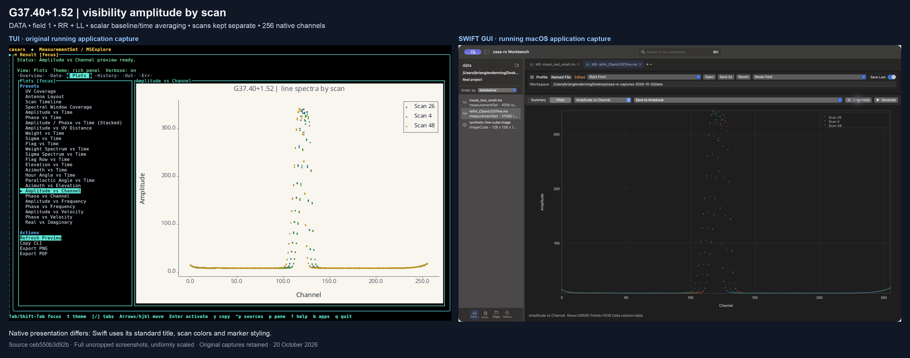
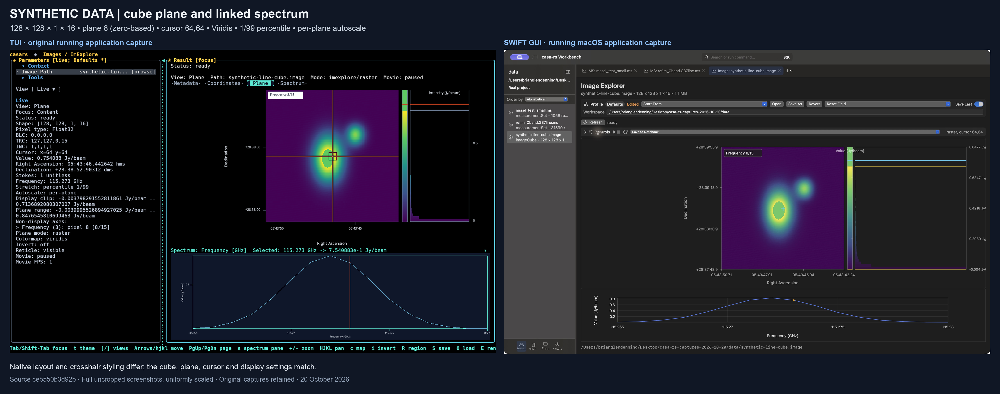
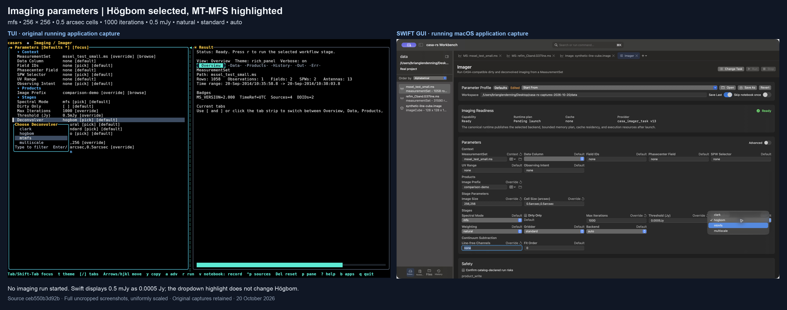
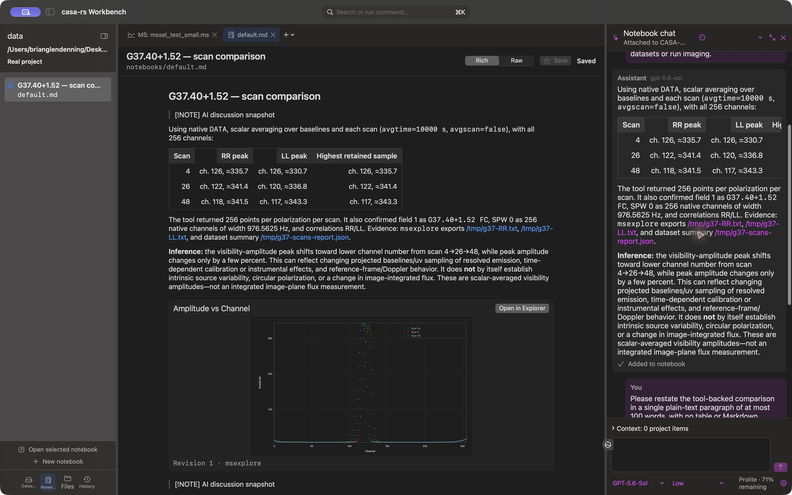

# casa-rs

Truth class: current descriptive
Last reality check: 2026-10-28
Verification: just docs-check


`casa-rs` is an experiment/hobby project by Brian Glendenning
(<i>brian@glendenning.net</i>), NRAO retiree. It is a from-scratch Rust
reimplementation of parts of CASA and casacore: persistent astronomical data,
radio-interferometric processing, and the supporting numerical and coordinate
infrastructure. CASA and casacore are used for interoperability tests,
calculation checks, and performance comparisons; they are not required as
runtime computation engines.

The source is almost entirely written by AI. I switch between Claude and
Codex, prompting them using various strategies. Experimenting with development
methodology is part of the hobby. You are welcome to experiment with the code,
and I am happy to answer questions, but there is no institutional support.
Independently authored source is LGPL-3.0-or-later; FFTW-linked distributions
are GPL-3.0-or-later. See [License](#license).

Python is the user-facing surface, alongside reusable Rust libraries and
command-line tasks. The [UI experiments](#ui-experiments) below record the
terminal and native macOS interfaces we explored and then retired.

## Current Status

The project implements substantial table, MeasurementSet, image, calibration,
flagging, simulation, and imaging functionality. It remains experimental:
implemented functionality is not a claim of complete CASA task or casacore
module parity, and APIs and workflows are still evolving. The workspace
version is `0.27.0`; published release assets may lag the checkout.

The central requirements are CASA-compatible persistent data and scientific
agreement with CASA. Tests compare both implementations' reads and writes,
and imaging acceptance normally targets normalized RMS differences around
0.001 together with metadata, mask, beam, flux, and other scientific checks.
Bitwise reproducibility is not the goal. Acceptance and performance evidence
are specific to the workload and configuration; passing a small test is not
blanket scientific validation. See [TESTING.md](TESTING.md).

| Capability | Current implementation |
|---|---|
| Tables and MeasurementSets | CASA-compatible storage managers, typed row/column/cell access, TaQL, MS selection and transformation, flag versions, and plotting/export data. |
| Images and coordinates | Persistent images, masks, regions, statistics, moments, image arithmetic, regridding, FITS import/export, coordinate systems, units, and measures. |
| Calibration and flagging | Native gain, bandpass, flux-scale, calibration application/generation, manual/clip/quack/tfcrop/rflag workflows, and diagnostic tasks. |
| Simulation and import | MeasurementSet simulation and VLA archive import, with comparison harnesses against CASA. |
| Imaging | Continuum and spectral cubes; standard, W-projection, mosaic, and AW-projection gridders; Högbom, Clark, multiscale, and MT-MFS deconvolution; masks, restoration, and primary-beam products. Not every combination is available. |
| Python | In-process NumPy-compatible table/image access, generated task wrappers, shared parameter profiles, and numeric MeasurementSet plot documents. |

The imaging foundation uses one compile/plan/run path through
`casa-imaging-application`, with separate owners for the measurement operator,
deconvolution, products, execution, and Metal acceleration. Explicitly
unsupported requests fail before execution. Current limits include:

- AW projection supports continuum/MT-MFS, not spectral cubes; native
  convolution-function generation is EVLA-specific.
- MT-MFS reconstructs Stokes I in one image domain.
- Facets use the standard gridder with single-term MFS.
- Metal supports standard and mosaic gridding with `f32` grids on suitable
  macOS hardware; W and AW projection use the CPU.

The authoritative availability checks are in
[`availability.rs`](crates/casa-imaging-application/src/availability.rs).
Current work and remaining acceptance obligations live in
[GitHub issues](https://github.com/bglenden/casa-rs/issues) and pull requests.

## Documentation

- [Documentation site](https://bglenden.github.io/casa-rs/)
  and [Rust API reference](https://bglenden.github.io/casa-rs/rustdoc/).
- [Python overview](docs/python/index.md), [data API](docs/python/data.md),
  and [API reference](docs/python/api.md).
- [Task parameter profiles](docs/task-parameters.md) and the
  [generated parameter reference](docs/reference/task-parameters.md).
- [Calibration guide](docs/casars-calibrate-user-guide.md).
- [Documentation index](docs/README.md), [architecture](ARCHITECTURE.md),
  and [testing and scientific evidence](TESTING.md).

The published docs are built from `main`. For a checkout or release tag, use
its corresponding source documentation.

## Using Python

The distribution is named `casa-rs-python`; import it as `casars`.

### Persistent data in process

```python
from casars.data import Image, Table

ms = Table.open("observation.ms")
print(ms.row_count, ms.column_names)

image = Image.open("target.image")
print(image.shape, image.units)
```

Numeric reads return NumPy arrays where the shape permits. Tables support
cell and column reads/writes; images support pixel-slice writes to existing
persistent images. Open with `writable=True` when writes are needed. Image
creation and coordinate-system editing are not part of the current Python
object API. See the [data API](docs/python/data.md) for the exact scope.

### Tasks and reusable parameters

```python
from casars import tasks

stats = tasks.imstat("target.image")
print(stats["rms"])
```

Named wrappers take CASA's parameters and run in the current directory;
`tasks.run(task_name, parameters=None, /, *, workspace=None, **values)` runs
any catalog task from a draft, in a chosen workspace. Each call resolves its
parameters through the shared Rust contracts and starts the task's own
executable, whose log reaches `sys.stderr` as it runs. They do not call CASA.
A task whose surface names its CASA task (every CASA-named task but `plotms`,
`tclean` among them) has CASA's signature and returns CASA's value, such as
`imstat`'s statistics dictionary, `flagdata`'s summary, `fluxscale`'s flux
densities or `tclean`'s summary record. A task that refuses its
parameters raises
`casars.tasks.TaskParameterError`, a `ValueError`; one that does not succeed
raises `casars.tasks.TaskExecutionError`.
Parameters can also be loaded, edited, validated, and saved as sparse TOML
profiles:

```python
from casars import parameters, tasks

p = parameters.load("profiles/target-imaging.toml", workspace="project")
p.update(niter=20000, threshold="1mJy")
result = tasks.run("tclean", p)
```

A task's command line (each task executable, such as `calibrate gaincal
...`) saves Last and Last Successful parameters in the workspace; Python task
calls save neither. CASA's own parameters are the consent to change data:
`overwrite=True` replaces a product, and a task that changes data in place
does so, as in CASA.
See [task parameters](docs/task-parameters.md) and the
[generated reference](docs/reference/task-parameters.md) for defaults and
supported options.

## Rust Libraries and Source Layout

`casa-*` crates contain reusable domain libraries and shared contracts;
`casars-*` crates contain the imager application, the `imexplore` and
`simobserve` task executables, and the Python package; the other task
executables are binaries of their domain crates. This is a native
implementation, not a wrapper around casacore C++.

| Area | Crates or source |
|---|---|
| Values and foundations | `casa-types`, internal `casa-values` and `casa-aipsio`, `casa-logging` |
| Persistent data | `casa-tables`, `casa-ms`, `casa-lattices`, `casa-images` |
| Coordinates and runtime catalogs | `casa-coordinates`, `casa-measures-data`, `casa-measures-tools` |
| Numerics and Fourier transforms | `casa-numerics`, `casa-fft` |
| Calibration, simulation, import | `casa-calibration`, `casa-simulation-synthesis`, `casa-vla` |
| Imaging | `casa-imaging-model`, `casa-imaging-operator`, `casa-imaging-deconvolution`, `casa-imaging-products`, `casa-imaging-runtime`, `casa-imaging-metal`, `casa-imaging-application` |
| Task contracts and execution | `casa-provider-contracts`, `casa-task-runtime`, `casars-imager`, `casars-imexplore`, `casars-simulation` |
| Python | `crates/casars-python/`, with its PyO3 extension `casars._core` |
| Comparison and test support | `casa-test-support`, `tools/perf/`, `tools/science/` |

The [application catalog](crates/casa-provider-contracts/resources/application-catalog.json)
and [parameter surfaces](crates/casa-provider-contracts/resources/parameter-surfaces.json)
are shared by the task executables and Python. The
[architecture document](ARCHITECTURE.md) describes ownership and dependency
rules in detail.

For example, the public `casa-types` value model can hold scalar, array, and
record values:

```rust
use casa_types::{ArrayValue, RecordField, RecordValue, ScalarValue, Value};

let temperature = Value::Scalar(ScalarValue::Float64(273.15));
let spectrum = Value::Array(ArrayValue::from_f32_vec(vec![1.0, 2.0, 3.0]));
let metadata = Value::Record(RecordValue::new(vec![
    RecordField::new("name", Value::Scalar(ScalarValue::String("demo".into()))),
    RecordField::new("temperature", temperature),
    RecordField::new("spectrum", spectrum),
]));
```

The crate APIs are idiomatic Rust, not a one-to-one copy of casacore's C++ API.
FITS image I/O currently uses `fitsio`/CFITSIO, and Fourier transforms use
FFTW. Broad casacore module parity, including its general fitting/scimath
and Python-converter APIs, is not the goal.

## License

Independently authored source is licensed under the [GNU Lesser General Public
License v3.0 or later](COPYING.LESSER) (SPDX: `LGPL-3.0-or-later`). Imaging
applications and Python extensions linked with FFTW are distributed as
combined works under [GNU GPL v3.0 or later](COPYING). See
[third-party notices](THIRD_PARTY_NOTICES.md) for FFTW's copyright and license.

## UI Experiments

We explored several user interfaces for casa-rs: Python bindings, a terminal
user interface (TUI), and a native Swift GUI. These experiments demonstrated
that multiple interfaces can share the same computational codebase and
task schemas, without reimplementing the scientific algorithms.

The TUI worked well in Ghostty using the kitty graphics protocol. This
approach is potentially portable across macOS, Windows, and Linux with a
compatible terminal, although only macOS was tested. In 2026, I am unsure
how much value a TUI adds when the cost of creating a native GUI is no longer
particularly high.

The Swift GUI also worked well and had no difficulty interoperating with
the main Rust computational codebase. The comparisons below show the TUI
on the left and the Swift GUI on the right.

*Visibility-amplitude spectra from the same G37.40+1.52 MeasurementSet and
selection. These are visibility amplitudes, not image-integrated flux.*



*The same plane of a synthetic image cube, with its linked spectrum.
This is synthetic test data.*



*Imaging parameter controls in the two interfaces.*



I also created an experimental notebook system with an integrated AI
assistant. Keeping discussion, analysis results, and plots together seemed
very promising. The screenshot below shows a genuine assistant conversation
that inspected the dataset through tools, with its response and a spectrum
saved in the notebook. I am still unsure how much this adds over using a
coding agent with the Python bindings, or a notebook environment such as
Jupyter AI.



Python is the focus for continued work. The TUI, the Swift GUI, the notebook
and assistant, the interactive image and table browsers, and Rust-side plot
rasterisation were removed in October 2026 (issue #833; see
[ADR-0017](docs/adr/0017-python-first-surface.md)). Their last state is
preserved at the tag
[`ui-experiments-2026-10-20`](https://github.com/bglenden/casa-rs/tree/ui-experiments-2026-10-20).

## Installation

The suite installer and release workflow target **macOS arm64** and
**Linux x86_64**. The release workflow builds CPython **3.10, 3.11, and 3.12**
wheels. Package metadata permits Python 3.10 or newer, but that does not mean
every newer interpreter has a bundled wheel. Choose an interpreter matching
the release's wheel assets.

### Install a published suite

Choose a version from the [releases page](https://github.com/bglenden/casa-rs/releases).
Set `version` to its version number without the leading `v`, then run the
installer attached to that release. For example, after setting `version`:

```bash
curl -fsSL "https://github.com/bglenden/casa-rs/releases/download/v${version}/install-casa-rs.sh" \
  -o install-casa-rs.sh
bash install-casa-rs.sh --version "$version" --python python3.12
```

This installs the catalog's binaries and a Python environment together under
`~/.local/opt/casa-rs/<version>/`. Stable installs normally update the `stable`
and `current` links; release candidates update `rc` without taking over
`current` unless `--activate` is supplied. The installer also links each of
the suite's task executables into `~/.local/bin` as `<command>-<channel>`
and, for the active suite, `<command>` (`calibrate`, `msexplore`,
`casars-imager`, and so on). `split`, `feather`, `immath` and `impv` stay off
`PATH`, since they are system commands or generic words (`split` runs as
`mstransform split`); Python still starts them from the suite.

Add that directory to your shell's `PATH`, then activate the suite's Python:

```bash
export PATH="$HOME/.local/bin:$PATH"
source "$HOME/.local/opt/casa-rs/current/python/bin/activate"
python -c "import casars; print(casars.__version__)"
```

The suite's Python finds the task executables in its own suite. To select
another installed suite explicitly, set `CASARS_SUITE_ROOT` to its versioned
root. A wheel installed outside a suite (from PyPI, say) provides the
in-process data bindings and tools, but its task calls need
`CASARS_SUITE_ROOT` or a task's own `CASARS_<APP>_BIN` override; see
[Install](docs/install.md).

### Build from source

Source builds require Rust **1.99 or newer**, a C/C++ toolchain, `pkg-config`,
and FFTW single- and double-precision libraries including their threaded/static
archives. Python packaging additionally needs Python 3.10 or newer and its
virtual-environment support. Install `just` for the repository commands.

Typical native dependencies:

```bash
# macOS
xcode-select --install
brew install fftw pkg-config just

# Debian/Ubuntu (install just separately if needed)
sudo apt install build-essential libfftw3-dev pkg-config python3-dev python3-venv
```

From the repository root:

```bash
rustup update stable
CARGO_INCREMENTAL=0 cargo build --release --workspace --bins
```

To build and install the Python/command-line suite from the checkout:

```bash
CARGO_INCREMENTAL=0 just install-local-suite
```

For an editable Python development environment, build the task executables
you need and install the package editable:

```bash
CARGO_INCREMENTAL=0 cargo build -p casa-calibration --bin calibrate
python3 -m venv .venv
source .venv/bin/activate
CARGO_INCREMENTAL=0 python -m pip install -e 'crates/casars-python[test,plot]'
```

`cargo build -p <package> --bin <executable>` builds one task executable
(`CARGO_INCREMENTAL=0 cargo build --workspace --bins` builds them all); the
[application catalog](crates/casa-provider-contracts/resources/application-catalog.json)
names each task's package and executable. Unless `CASARS_SUITE_ROOT` is
set, a package built from a checkout runs the newest `debug` or `release`
build of each executable in that checkout's `target/` (or
`$CARGO_TARGET_DIR`), and a missing build is reported with the `cargo build`
command that makes it. To run another file, set the task's override, such as
`CASARS_CALIBRATE_BIN` or `CASARS_IMAGER_BIN`. Nothing searches `PATH` or
runs `cargo`.

Before building for performance measurements or release, use the pinned
SIMD-enabled FFTW recipe rather than assuming the system package has the
required kernels:

```bash
bash scripts/build-fftw.sh /absolute/durable/fftw-3.3.11
export PKG_CONFIG_PATH=/absolute/durable/fftw-3.3.11/lib/pkgconfig
```

The recipe builds static, position-independent single/double precision and
pthread libraries with ARM NEON or runtime-dispatched x86 SIMD. It retains
the source and build recipe. Release bundles include the corresponding FFTW
source and do not need a local FFTW development installation to run.

## Measures Data

Astronomical conversions use a CASA-table-backed measures runtime containing
Earth orientation, leap seconds, observatories, geomagnetic data, ephemerides,
and source/line catalogs. Applications open a fallible `MeasuresRuntime` at an
operation boundary and pass it to the computations. Discovery checks
`CASA_RS_MEASURESPATH` and `~/.casa/data`; it does not install or refresh data.
Missing, incomplete, stale, or corrupt runtimes produce errors.

To download and refresh a runtime explicitly from a source checkout:

```bash
CARGO_INCREMENTAL=0 cargo run --example update_measures \
  -p casa-measures-data --features update -- --data-dir /path/to/measures-data
export CASA_RS_MEASURESPATH=/path/to/measures-data
```

Omitting `--data-dir` selects `~/.casa/data`. A packaged snapshot can also be
installed explicitly with `casa_measures_data::install_packaged_snapshot`;
scientific calls do not silently install it. Maintainers regenerate the
packaged archive and provenance with:

```bash
CARGO_INCREMENTAL=0 cargo run -p casa-measures-tools --bin package_snapshot \
  -- --input /path/to/measures-data
```

## Development and Verification

[`AGENTS.md`](AGENTS.md) is the repository operating contract;
[`TESTING.md`](TESTING.md) defines the gates and external test-data requirements.
Accepted decisions are in [`docs/adr/`](docs/adr/), and issues/PRs are the work
record.

```bash
just quick       # architecture, formatting, clippy, workspace tests, tooling checks
just verify      # quick plus frontend binding and Python package checks
just docs-check  # documentation and generated-contract consistency
```

Install `cargo-nextest` to run the workspace tests in parallel. Raw Cargo
commands should set `CARGO_INCREMENTAL=0`. Imaging changes also need the
applicable component, end-to-end, and CASA comparison tiers described in
`TESTING.md`; the general quick gate is not a substitute for scientific
acceptance.

Build local Rust API docs with
`CARGO_INCREMENTAL=0 cargo doc --workspace --no-deps`.

The optional staged-file SPDX hook can be enabled with
`git config core.hooksPath .githooks`.

Tagged `v*` releases trigger the Python release workflow, which builds wheels,
a source distribution, suite and standalone-binary bundles, and the installer.
The workflow publishes release assets and can publish Python distributions
when the PyPI credential is configured. Release procedures are documented in
[`docs/agent-reference.md`](docs/agent-reference.md).
