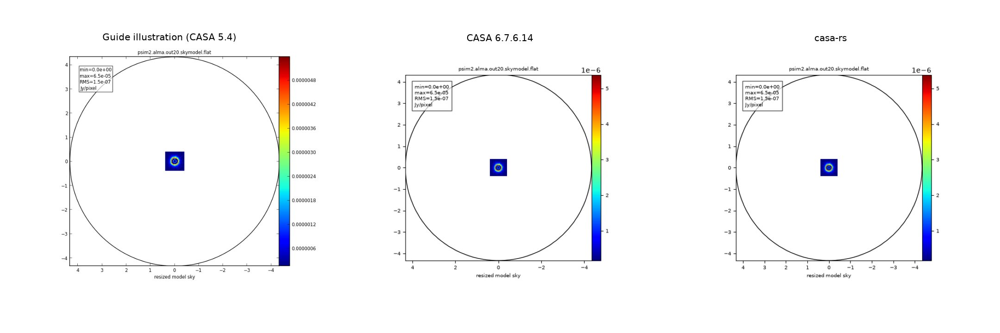
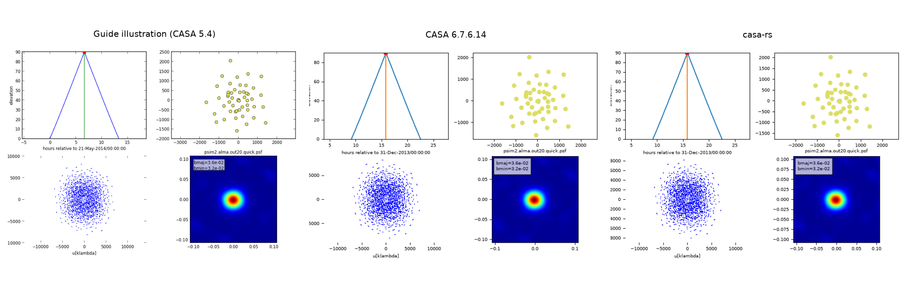
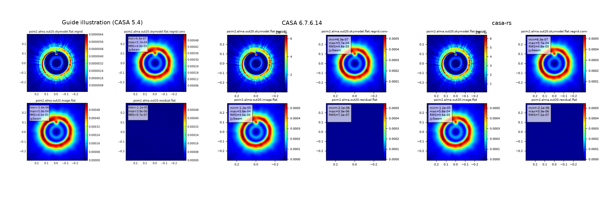
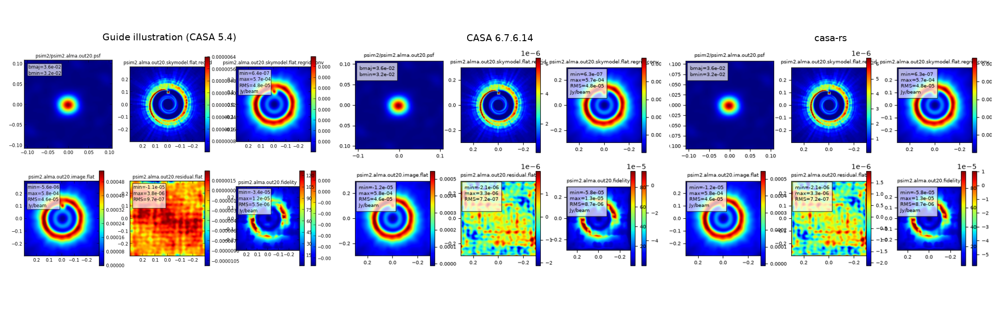
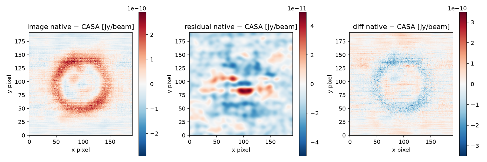

# ALMA protoplanetary disk tutorial

Truth class: current descriptive
Last reality check: 2026-11-15
Verification: just docs-check

This is the `simulation/ppdisk-alma-former` outcome, work issue
[#180](https://github.com/bglenden/casa-rs/issues/180). It implements the
single-interferometric-MS `simanalyze` route needed by the disk tutorial.
Multi-array, total-power and `simalma` integration remain on
[#841](https://github.com/bglenden/casa-rs/issues/841).

## Source and sequence

The source is [CASA Guide revision 41893](https://casaguides.nrao.edu/index.php?title=Protoplanetary_Disk_Simulation_CASA_6.6.6&oldid=41893),
labelled CASA 6.6.6. Its four illustrations retain CASA 5.4 filenames.
The current project oracle is CASA **6.7.6.14**, superseding the old ticket's
6.7.5-9 baseline. Historical illustrations are shown for human comparison;
the numerical reference comes from the installed current CASA.

The public input is [ppdisk672_GHz_50pc.fits](https://bulk.cv.nrao.edu/almadata/public/casaguides/sim_inputs/ppdisk672_GHz_50pc.fits),
the Wolf & D'Angelo (2005) disk model. Cite that paper for scientific use.
The unmodified 270 KiB FITS is a small import regression fixture; full MS,
images, renderer arrays and transient runs stay outside default gates.
The antenna input is CASA's public `alma/simmos/alma.out20.cfg`, supplied
explicitly to both engines from the same runtime-data installation.

The Guide sequence is `imhead`; `ia.open/shape/toworld/close` and
`qa.formxxx` to inspect the centre; `simobserve`; `simanalyze`.
The observation uses J2000 `18h00m00.031s -22d59m59.6s`, a 0.76 arcsec map,
1200 seconds, ALMA out20 and no thermal noise. Imaging uses 192×192 pixels,
natural weighting, 10,000 Clark iterations, threshold `1e-7Jy`, the input
model as start model, and residual/convolved-model analysis panels.

### Explicit differences and classified steps

| Step | Classification and impact |
| --- | --- |
| CASA's interactive `default/inp/go` shell | External shell convenience. Both Python routes pass the same explicit task arguments and canonical defaults. |
| Header inspection | Both routes call their native `imhead` on the original FITS. Native FITS import now follows casacore's legacy `FREQ-LSR`, uppercase `HZ`, `RESTFREQ` and FITS brightness-unit aliases. |
| `ia.open/shape/toworld/close` introspection | The public native image-tool methods remain deferred on [#1027](https://github.com/bglenden/casa-rs/issues/1027): expose FITS/image shape and world-coordinate conversion through that tool. This does not gate simulation: its existing Rust coordinate library computes the same model centre during task preparation. The independent CASA centre is `18:00:00.03100 -022.59.59.602830`; the Guide supplies the observing direction explicitly. |
| FITS start model | Literal Guide `simanalyze(modelimage='...fits')` fails in CASA 6.7.6.14 with “Model image … is not a readable Table”. Both controlled routes use their **own** lossless `importfits` first. Native execution never invokes CASA. |
| Stored observation time | Use the existing approved `simobserve_parity.casars_params` UTC/TAI comparison rule: native `hourangle='35s'` gives exactly the same stored TIME for the Guide's 2014 default date. Production defaults are unchanged. |
| Screen display | External interactive display. Both evidence runs use headless `graphics='file'`, preserving every tutorial PNG and panel selection. The shared renderer also handles screen/both. |
| Fidelity | Preserve CASA's original result, plus an independent CASA control changing only its `%f` floor to full precision. Native fidelity follows the existing [documented corrections](../CASA%20(C%2B%2B)%20bugs.md#simanalyze-writes-the-fidelitys-floor-to-six-decimal-places): full-precision floor and dimensionless ratio. |
| Seven selected analysis panels | CASA warns about six axes, then draws fidelity over difference in the sixth panel. The native document retains both complete layers and their colour scales in that panel. |
| `.tclean.last` | Not produced: the programme's existing task-parameter policy does not save implicit last files. Numerical products are independent of graphics. |
| Failed rerun / selected input overlap | Native preparation preserves prior products and refuses input/output collisions, correcting CASA's deletion before preparation succeeds; recorded in the CASA bugs document. |

All four workflow figures are reproduced. No Guide output table is present.
The input's scientific interpretation, image/MS persistence and dependency
set are unchanged. No new crate family or major algorithm is introduced.
`simanalyze` adds a native application/catalog entry and its CASA parameters,
reusing the simulation result and plot wire shapes. Its automatic zero/empty
geometry has separate semantic concepts from explicit positive `tclean`
geometry. Nondefault interactive cleaning, multi-MS, total power, feather
integration and custom logging remain explicit refusals with owning issues.

## Numerical and figure evidence

The [machine-readable comparison](ppdisk-alma/comparison.json) records all
15 image products, masks/units/coordinates/beams, the full 147,000-row MS,
and the four figures' actual artists. Numerical acceptance is normalized
RMS ≤0.001. The figure check compares every plotted sample/pixel, panel
count, selection, axes, labels, units, display limits, markers, colours,
statistics annotations and font sizes. Numerical limits use the same
relative scientific tolerance; raster subtraction is not an acceptance gate.
WCS references, increments and reference pixels are checked axis by axis,
with frame identifiers and projection; negative controls reject angular
errors even when a much larger spectral value is unchanged.
Original CASA fidelity is reported separately from its corrected control.

Each row below places the original Guide illustration, current CASA and
native output side by side. The Guide and current CASA can differ because
of their versions; the current paired run is the scientific comparison.

| Guide figure | Guide / CASA 6.7.6.14 / casa-rs |
| --- | --- |
| `psim2-5.4.alma.out20.skymodel.png` |  |
| `psim2-5.4.alma.out20.observe.png` |  |
| `psim2-5.4.alma.out20.image.png` |  |
| `psim2-5.4.alma.out20.analysis.png` |  |



## Reproduce

Use separate output directories and the same model/configuration files.
`NATIVEPY` imports the installed casa-rs Python extension and its plot extras;
`CASAPY` is CASA 6.7.6.14's Python. Set the ordinary task binary overrides
(or suite root) to the release build. A valid measures runtime is required.

```sh
python tools/simulation/ppdisk_tutorial.py --engine download --out target/ppdisk-inputs
cargo build --release -p casars-simulation --bins -p casa-images --bins -p casars-imexplore --bin imexplore
CASAPY tools/simulation/ppdisk_tutorial.py --engine casa \
  --out target/ppdisk/casa --model target/ppdisk-inputs/ppdisk672_GHz_50pc.fits \
  --config /path/to/alma/simmos/alma.out20.cfg --repeats 3
NATIVEPY tools/simulation/ppdisk_tutorial.py --engine native \
  --out target/ppdisk/native --model target/ppdisk-inputs/ppdisk672_GHz_50pc.fits \
  --config /path/to/alma/simmos/alma.out20.cfg --repeats 3
CASAPY tools/simulation/compare_ppdisk_tutorial.py \
  --casa target/ppdisk/casa --native target/ppdisk/native \
  --guides target/ppdisk-inputs/guide-figures --out target/ppdisk/review
```

The default end-to-end regression uses the same small eight-antenna inputs
as the existing graphics oracle and compares 13 products from an actual
CASA run, including the documented full-precision fidelity control:

```sh
cargo test -p casa-images --test legacy_simulation_fits
cargo test -p casa-simulation --test simanalyze_task_casa
python frontends/casars-python/python/tests/test_ppdisk_tutorial.py
```

## Timing

The retained timing record accompanies the numerical comparison. It uses
release native binaries, the same host and inputs, serial runs without
concurrent compilation, and includes import, task-process startup, all
scientific outputs and file rendering. These small end-to-end timings are
not representative imaging benchmarks.

[Timing samples](ppdisk-alma/timing.json), median of three runs:

| Engine | Import | Simulate + figures | Image/analyze + figures | Total |
| --- | ---: | ---: | ---: | ---: |
| CASA 6.7.6.14 | 0.019 s | 2.385 s | 7.774 s | 10.182 s |
| casa-rs release | 0.013 s | 3.227 s | 3.340 s | 6.587 s |

Native total time is 1.55× faster on this case. Both runs include evidence artist capture; source/runtime imports and initial header inspection precede the timed task sequence.
